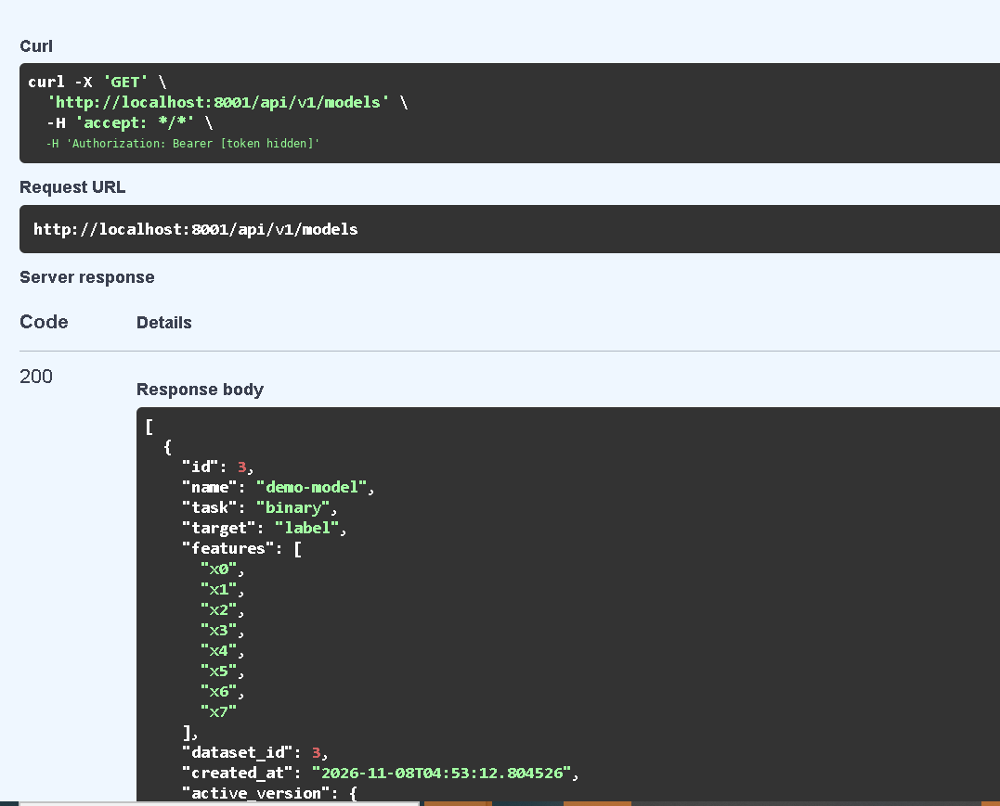
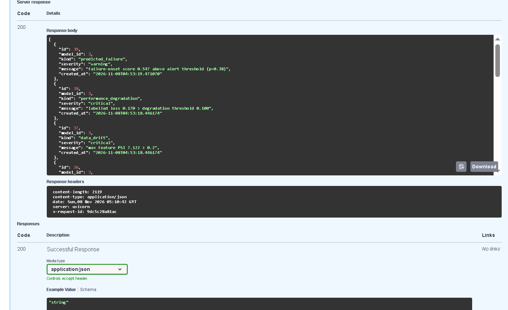
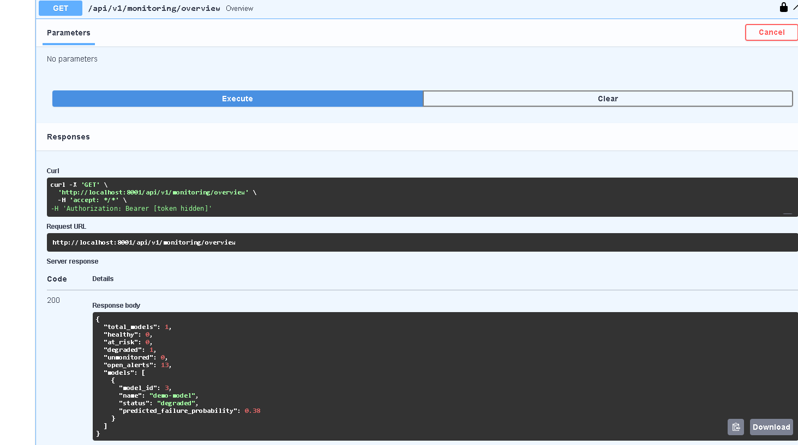
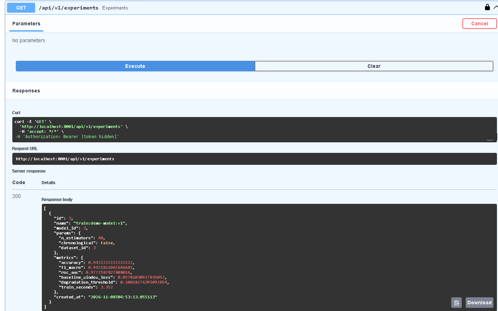
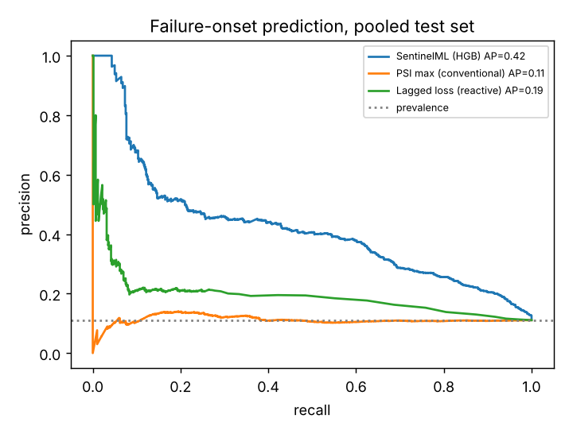
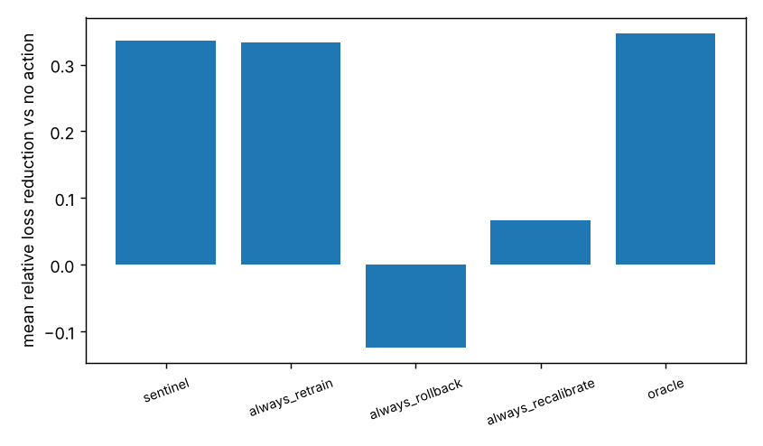

# SentinelML

**Predictive reliability monitoring, root-cause diagnosis and counterfactual recovery for deployed ML models.**

Research question: *can temporal failure prediction, root-cause diagnosis and counterfactual recovery evaluation improve
the reliability of deployed ML systems compared with conventional threshold-based monitoring?*

> **Read this first - honest status.** The ML core, a reproducible failure benchmark, 8 experiments, a FastAPI backend and
> 31 automated tests are implemented and were actually run. A React frontend, a live AWS deployment, a demo video 
>  are **not** done (see [docs/LIMITATIONS_AND_STATUS.md](docs/LIMITATIONS_AND_STATUS.md)). All experimental
> results are on a **simulated** failure benchmark that I designed; they show the approach is promising there, not that it
> works on real production systems.

## What it does
| Module | File | What it does |
|---|---|---|
| Failure injection | `failures.py` | 7 failure types (covariate shift, concept drift, missing values, corruption, label shift, pipeline unit mismatch, outliers) x severity x sudden/gradual, with ground-truth labels |
| Monitoring | `drift.py`, `monitor.py` | PSI, KS, Wasserstein, JS, missing/outlier/duplicate/schema checks, uncertainty, prediction drift, correlation shift; causal rolling features |
| Failure prediction | `predictor.py` | "Will the healthy model start degrading in the next H windows?" - LR / RF / HGB / XGBoost / LightGBM, chronological splits with purge gaps, validation-tuned alert threshold, isotonic calibration |
| Root cause | `rca.py` | KS/PSI evidence, SHAP attribution shift, counterfactual *distribution restoration*, learned failure-type classifier |
| Recovery | `recovery.py` | 7 candidate actions simulated offline on held-out labelled windows, regression guard, cost, ranking; human-approval state machine |
| API | `api/` | JWT auth, datasets, training/versioning, prediction logging, monitoring, failure prediction, diagnosis, recovery workflow, experiments |

## Quick start
```bash
pip install -e ".[api,tracking,dev]"
pytest -o addopts=""                       # 31 tests, ~1 min
uvicorn sentinelml.api.main:app --reload   # http://localhost:8000/docs
# reproduce the research results (CPU only; ~20 min for the benchmark on 1 core)
python experiments/run_benchmark.py        # 5 datasets x 8 streams -> results/cache
python experiments/analyze.py              # -> results/RESULTS.md, results.json, figures/
python scripts/train_failure_predictor.py  # -> artifacts/ used by the API
python scripts/train_baselines.py --dataset breast_cancer   # Phase-4 baselines (+ MLflow if SENTINEL_MLFLOW=1)
```
Windows cmd instructions: [docs/RUN_ON_WINDOWS.md](docs/RUN_ON_WINDOWS.md). Guided demo against a running server: `python scripts/demo_api_flow.py`.
API configuration is by environment variable: `DATABASE_URL` (SQLite default, PostgreSQL supported), `SECRET_KEY`, `ARTIFACT_DIR`.
Docker: `cp .env.example .env && docker compose up --build` (the API image builds in GitHub Actions CI; `docker compose up` itself has not been run).

## Results (all computed by `experiments/analyze.py`; full tables in `results/RESULTS.md`)
Benchmark: 5 datasets (breast_cancer, wine, synthetic binary / multiclass / regression) x 8 streams x 600 windows, 400 injected
events. **Only 231 of 400 events (58%) actually degraded the model** (concept drift 100%, outliers 27%): drift is not failure.
Horizon H = 6 windows, 95% CIs by bootstrap over whole streams.

**E1 - predictive vs threshold monitoring (pooled test windows, n_episodes = 113)**
| method | PR-AUC [95% CI] | ROC-AUC | precision | recall | false alarms /100 healthy windows | episodes warned |
|---|---|---|---|---|---|---|
| SentinelML (HGB) | **0.42** [0.32, 0.51] | 0.83 | 0.39 | 0.56 | 10.9 | 80% (mean lead 5.1 of 6 windows) |
| PSI > 0.2 (conventional) | 0.11 [0.08, 0.17] | 0.50 | 0.11 | 0.83 | 84.0 | 100% (it alerts almost constantly) |
| PSI, threshold tuned on validation | 0.11 | 0.50 | 0.11 | 0.39 | 39.4 | 55% |
| Lagged-loss threshold (reactive) | 0.19 [0.14, 0.24] | 0.66 | 0.21 | 0.26 | 12.2 | 27% |
Prevalence of the positive class: 0.11. **Interpretation:** drift magnitude alone carries essentially no information about
*imminent degradation* here (ROC 0.50), because many drifts are harmless; combining drift, uncertainty and trend features
helps substantially. Caveats: the baseline is a single-signal rule (a tuned multi-signal baseline was not evaluated), and the
simulator and the predictor features were designed by the same person.

**Read the pooled numbers with these caveats (from the per-dataset tables in `results/RESULTS.md`):**
- With each dataset's own model, SentinelML's PR-AUC is above PSI>0.2 on all 5 datasets (breast_cancer 0.12 vs 0.06, synth_binary 0.23 vs 0.14,
  synth_multiclass 0.35 vs 0.22, synth_regression 0.53 vs 0.26, wine 0.29 vs 0.17), but **every per-dataset confidence interval overlaps**; only the pooled comparison (40 streams) separates.
- The pooled PR-AUC is helped by dataset mix: degraded fractions differ (synth_regression 48% of windows, breast_cancer 16%) and PR-AUC rises with prevalence.
- The "10.9 false alarms /100" is pooled; per dataset (own model) it ranges 9.6-53.2, and precision is only 0.12-0.23 on four of five datasets.
- Alert thresholds transfer poorly to unseen datasets (e.g. wine: threshold learned elsewhere warns 19% of episodes); ranking quality (ROC-AUC 0.68-0.80 vs 0.56-0.63 for PSI) transfers better.

**E2 algorithms** (PR-AUC): LR 0.32, RF 0.40, HGB 0.42, XGB 0.43, LightGBM 0.42 - boosted trees best but CIs overlap heavily.
**E3 leave-one-dataset-out** (PR-AUC SentinelML vs PSI>0.2): breast_cancer 0.26 vs 0.06, synth_binary 0.22 vs 0.14,
synth_multiclass 0.35 vs 0.22, synth_regression 0.38 vs 0.26, wine 0.29 vs 0.17 - better on every held-out dataset, but
**per-dataset CIs overlap** and calibration worsens on unseen datasets (ECE 0.05-0.14 vs 0.03 in-distribution).
**E4**: H=3 -> PR-AUC 0.32 (vs 0.08), H=12 -> 0.53 (vs 0.18). Episodes warned: gradual 85% (73), sudden 70% (40). *The
"warning" for sudden failures is largely the 1-3 window lag of the smoothed-loss degradation definition, not true foresight.*
**E5 root cause** (162 feature-level incidents): any-hit@3 of the true corrupted feature - combined 0.975, PSI 0.969,
imp-weighted KS 0.975, KS 0.926, SHAP-shift 0.920, restoration 0.895, random 0.463. **Plain PSI/KS are as good as SHAP or the
counterfactual test; I found no evidence that SHAP adds value on this benchmark.** Failure-type classifier (255 incidents,
grouped CV): accuracy 0.969, macro-F1 0.964 vs 0.184 majority - but injected failure types are cleanly separable by
construction; real incidents will be harder.
**E6 recovery** (255 incidents; success = future loss >=10% lower, harm = >5% higher):
| policy | mean relative loss reduction | success | harm |
|---|---|---|---|
| SentinelML recommendation | 33.6% | 69.8% | **0.8%** |
| always retrain on recent data | 33.3% | 66.7% | 5.5% |
| always roll back | -12.4% | 6.3% | 52.2% |
| always recalibrate | 6.7% | 29.0% | 7.8% |
| oracle (best feasible in hindsight) | 34.7% | 72.2% | 0.0% |
The gain over "always retrain" is in **safety** (fewer harmful actions), not in average improvement. Concept-drift incidents are
essentially unrecoverable here (+1.8%): the injected label corruption cannot be learned away.
**E7 ablation** (PR-AUC): full 0.42; no drift 0.39; no quality 0.41; no uncertainty 0.40; no lagged loss 0.39; no temporal
features 0.36 (ROC 0.83 -> 0.75). Every individual removal stays inside the CI; temporal features matter most.
**E8 severity**: recall is flat (0.53 / 0.56 / 0.57 for low / mid / high severity) - I could not show a severity effect.

## Screenshots (real, from a Windows 10 run; tokens hidden)
| | |
|---|---|
|  |  |
|  |  |
|  |  |
Terminal output of the guided demo: [docs/demo_output.txt](docs/demo_output.txt). Verification log: [docs/VERIFICATION.md](docs/VERIFICATION.md). Technical report: [docs/REPORT.md](docs/REPORT.md). Resume/pitch: [docs/RESUME_AND_PITCH.md](docs/RESUME_AND_PITCH.md).

## Repository map
`sentinelml/` library + API | `experiments/` benchmark + analysis | `scripts/` baselines & artifact training | `tests/` 31 tests |
`results/` cached benchmark, RESULTS.md, figures | `docs/` architecture, literature, competitors, methodology, limitations,
interview prep | `deploy/aws/` untested deployment plan | `dashboard/` Streamlit prototype (untested UI)
