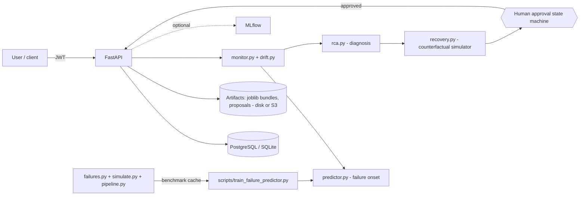
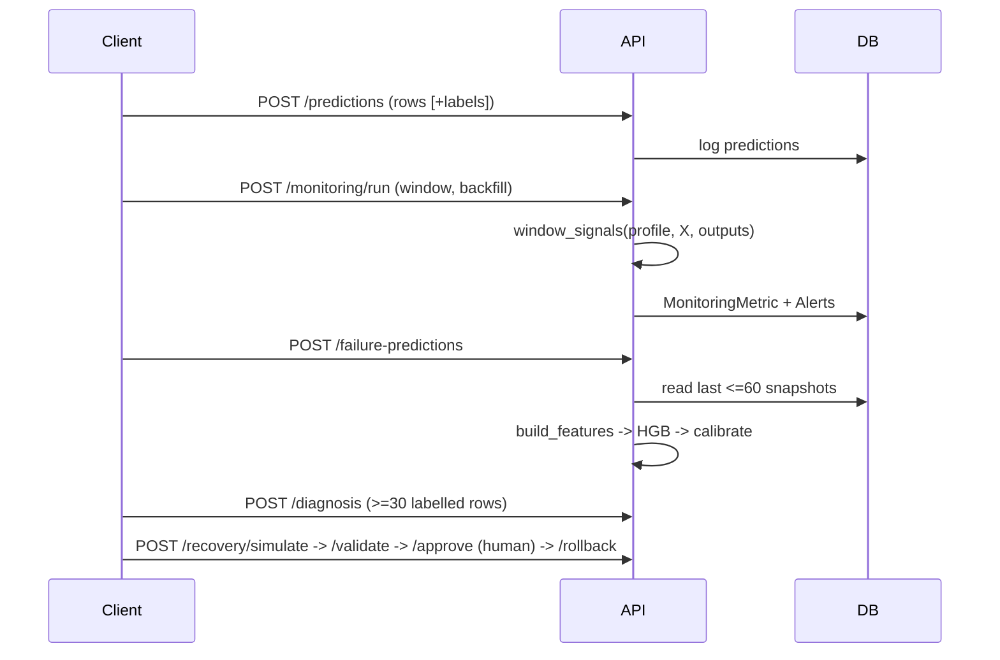
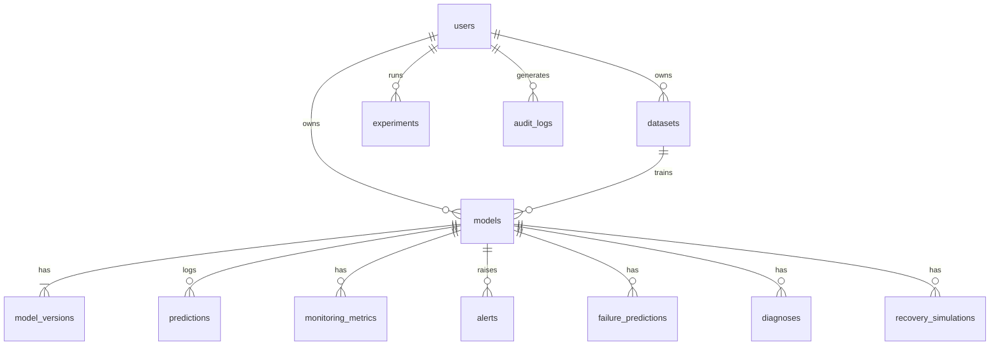

# Architecture

## Components

## Serving data flow

## Recovery state machine
`proposed -> validated | validation_failed -> approved -> applied -> rolled_back`; `rejected` reachable before apply.
Approval requires a human actor and a passed validation on holdout windows not used for fitting or ranking.
In this API `approve` = approve **and** deploy as a new production version; the previous version is archived and can be restored with `rollback`.

## Data model (tables in `api/db.py`)

`organizations` from the original spec are **not implemented** (single-owner tenancy; every resource is scoped by `owner_id`
and returns 404 to other users - tested). Alembic migrations are **not** provided: tables are created with `create_all`.

## Technology choices
FastAPI+Pydantic (typed validation, OpenAPI) | SQLAlchemy 2 (SQLite for dev/tests, PostgreSQL in prod) | scikit-learn RF as the
monitored model (tree ensembles give cheap uncertainty and TreeSHAP) | HistGradientBoosting as predictor (handles NaN natively, CPU-fast) |
PyJWT + PBKDF2 (no extra native deps) | MLflow optional behind `tracking.py` | Prefect/Airflow **not** used: monitoring is triggered by
API calls / cron; adding an orchestrator was not justified at this scale | TimescaleDB not used (plain tables suffice for the tested scale).
